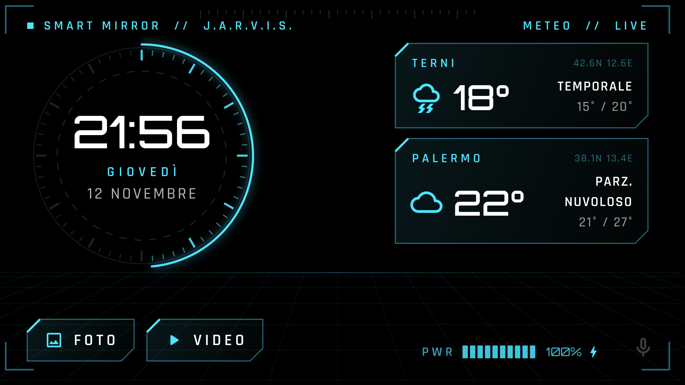

<p align="center">
  
</p>

<h1 align="center">Smart mirror</h1>

<p align="center">
  Un vecchio telefono Android dietro un vetro bidirezionale diventa uno specchio intelligente,<br>
  con <b>J.A.R.V.I.S.</b>, un assistente vocale che gira tutto sul telefono e ti chiama "Signore".
</p>

<p align="center">
  
</p>

<p align="center">
  
</p>

## Cosa fa

- **Ora e data** in un quadrante HUD futuristico. Il fondo è nero: dietro il vetro il nero fa da specchio.
- **Meteo** di più città (Open-Meteo, senza chiavi): attuale, ora per ora e 7 giorni.
- **Foto e video** presi da una cartella sul telefono.
- **Jarvis, assistente vocale offline**: riconoscimento con [Vosk](https://alphacephei.com/vosk/), nessun audio inviato a server.
  - Si attiva solo con il suo nome: "Jarvis avanti" funziona, "avanti" da solo no.
  - Tono ironico da maggiordomo inglese ("Signore, in sintesi: ombrello. Molto british.").
  - Si può interrompere mentre parla, grazie all'antieco del telefono in modalità vivavoce.
  - Legge il meteo, cerca notizie su internet (Google News RSS), regola il volume.
- **Risparmio batteria**: dopo 5 minuti senza nessuno lo schermo si spegne davvero. Si riaccende passando la mano davanti al sensore di prossimità.
- **Avviso batteria** sotto il 30%. Lo specchio si ricarica solo quando serve.
- Fa da **schermata Home**: si apre da solo all'accensione, senza schermata di blocco.

## Comandi vocali

| Dici | Jarvis… |
|---|---|
| Jarvis, che sai fare? | elenca i comandi |
| Jarvis meteo / meteo Palermo | legge le previsioni di oggi |
| Jarvis meteo domani / sabato / settimana | un giorno, o tutta la settimana |
| Jarvis foto / video | apre la galleria o il video |
| Jarvis avanti / indietro | foto, giorno o notizia successivi |
| Jarvis pausa / riprendi | controlla il video |
| Jarvis notizie / Jarvis cerca… | ultime notizie o ricerca libera |
| Jarvis volume sette / alza / abbassa | volume da 0 a 10 |
| Jarvis stop | smette di parlare |
| Jarvis spegni | spegne lo schermo |

## Hardware

- Telefono Android 8 o più recente. Provato su un Samsung Galaxy A5 2017, in orizzontale.
- Vetro bidirezionale (specchio spia) davanti al telefono.
- Alimentatore: l'app avvisa quando la batteria scende sotto il 30%.

## Installazione

Serve [Flutter](https://flutter.dev) 3.41 o più recente, con l'SDK Android.

```powershell
.\scarica-modello.ps1          # modello vocale italiano Vosk (~48 MB)
flutter build apk --release
adb install -r build\app\outputs\flutter-apk\app-release.apk
.\carica-media.ps1             # copia modello, foto e video sul telefono
```

Foto e video vanno nelle cartelle `media/foto` e `media/video`, che non vengono pubblicate su git.

Sul telefono:
1. Premi Home, scegli **Smart mirror** e poi **Sempre**.
2. Accetta i permessi richiesti: microfono e amministratore dispositivo (serve solo a spegnere lo schermo).
3. Disattiva Always On Display e imposta il blocco schermo su "Nessuno".

## Personalizzare

- **Città del meteo**: costante `citta` in [`lib/main.dart`](lib/main.dart).
- **Minuti di schermo acceso**: `minutiAcceso` in [`lib/sistema.dart`](lib/sistema.dart).
- **Comandi e battute di Jarvis**: [`lib/jarvis.dart`](lib/jarvis.dart).

## Crediti

- Riconoscimento vocale: [Vosk](https://alphacephei.com/vosk/) con il modello `vosk-model-small-it-0.22` (Apache 2.0).
- Meteo: [Open-Meteo](https://open-meteo.com). Notizie: Google News RSS.
- Font: [Orbitron](https://fonts.google.com/specimen/Orbitron) e [Rajdhani](https://fonts.google.com/specimen/Rajdhani) (SIL Open Font License).
